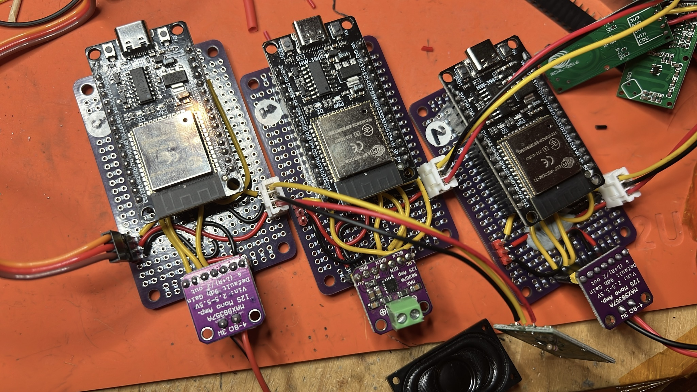
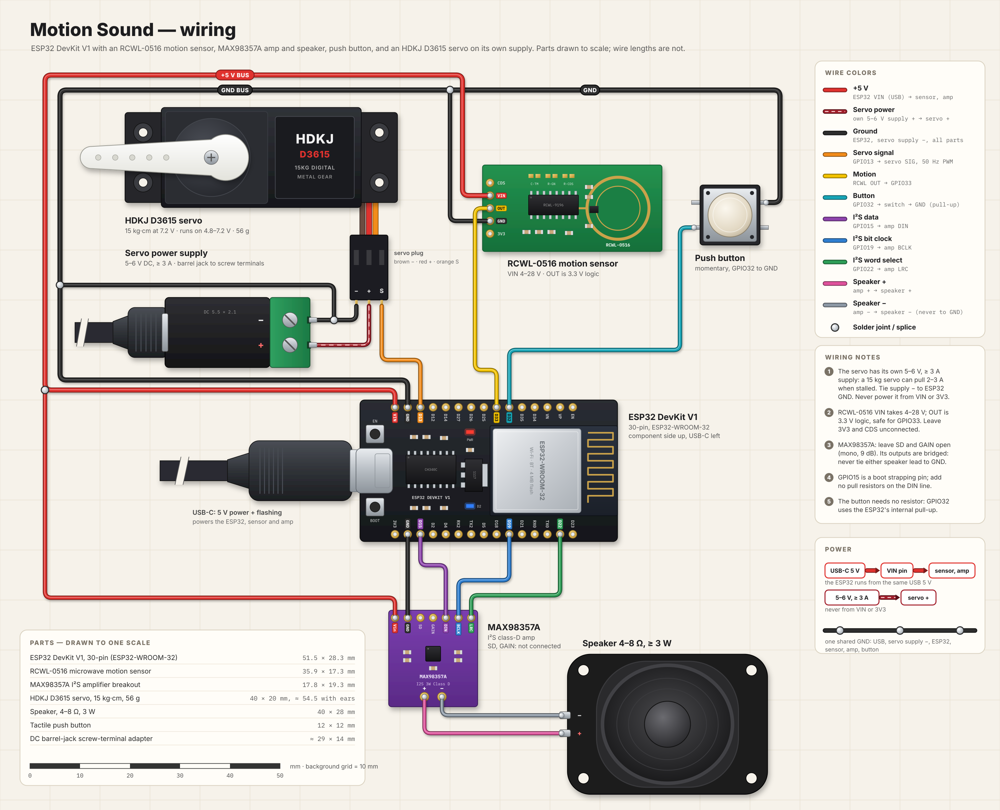

# Motion Sound

An example project for building a standalone ESPHome sound-effects (SFX) device, used to make an interactive object that plays a sound and moves something when motion is detected. An ESP32-WROOM DevKit V1 reads a binary presence/motion sensor, plays a random short meow stored in firmware flash as MP3 through a MAX98357 I²S amplifier, and sweeps a servo-driven cat arm once before holding it at center. Detection, random selection, and playback run locally on the device. Wi-Fi and Home Assistant add remote controls and OTA updates, but are not required.



## Hardware and wiring



The diagram draws every part at the same scale (wire lengths are not to scale). The ESP32 runs from USB 5 V, and the motion sensor and amplifier take 5 V from its VIN pin. The servo has its own supply, and that supply's negative terminal is tied to ESP32 GND.

| Signal | ESP32 GPIO | Connect to |
| --- | ---: | --- |
| Motion sensor output | GPIO33 | RCWL-0516 OUT |
| Button | GPIO32 | Momentary switch to GND (internal pull-up) |
| Servo signal | GPIO13 | Servo signal wire (orange on most servos), 50 Hz PWM |
| I²S data out (DIN) | GPIO15 | MAX98357 DIN |
| I²S word select (LRCLK/WS) | GPIO22 | MAX98357 LRCLK |
| I²S bit clock (BCLK) | GPIO19 | MAX98357 BCLK |
| Sensor and amplifier power | VIN (5 V), GND | RCWL-0516 VIN/GND and MAX98357 VIN/GND |
| Servo power | GND | Separate 5–6 V DC supply rated for at least 3 A to servo + and −; also connect supply − to ESP32 GND |
| Speaker output | — | Connect a 4 Ω+ speaker across the amplifier outputs; do not ground either output |

The arm uses an HDKJ D3615: a standard-size (40 × 20 × 40.5 mm, 56 g) digital metal-gear servo rated for 4.8–7.2 V, with 14 kg·cm of torque at 6 V and 15 kg·cm at 7.2 V. Its stall current is not published, but servos in this class draw 2–3 A when stalled, which is more than USB and the ESP32 VIN pin can supply. Power it from its own 5–6 V supply rated for at least 3 A, and connect the supply's negative terminal to ESP32 GND so the GPIO13 signal has a common reference. Do not power the servo from VIN or the 3.3 V pin. The firmware keeps the servo attached at center between movements, so it holds position whenever the device is on.

Confirm the presence sensor's output polarity and electrical level before connecting it; ESP32 GPIOs are not 5 V tolerant. The RCWL-0516 takes 4–28 V at VIN and drives OUT at 3.3 V, so it can connect to GPIO33 directly; leave its 3V3 and CDS pins unconnected. GPIO15 is a boot-strapping pin; the MAX98357 DIN input should be high impedance, but avoid adding pulls to GPIO15 and move I²S DOUT to another suitable GPIO if the board has boot issues.

For amplifier pinout details, see [Adafruit's MAX98357 pinout guide](https://learn.adafruit.com/adafruit-max98357-i2s-class-d-mono-amp/pinouts). The MAX98357 takes digital I²S (not analog audio), and MCLK is not required. Leave SD and GAIN unconnected for mono (L+R)/2 output at 9 dB gain. Its speaker outputs are bridge-tied/floating: use a 4 Ω or higher moving-coil speaker across the output pair, and do not connect either speaker terminal to ground. The amp supply range is 2.5–5.5 V; Adafruit recommends 5 V for higher output power with a supply sized for the speaker load. ESP32 3.3 V logic is compatible with the I²S inputs. Follow the markings/specifications for the specific amplifier breakout in use.

## Behavior

### Motion and short button presses

Each motion rising edge, and each button press released within 3 seconds, runs the same sequence:

- **Sound:** a clip picked at random from the `MEOWS` list in `play_random_meow` (25 meows plus `hola`) plays unless sound is muted or rate limited. A new clip interrupts the one already playing.
- **Arm:** the servo eases from center to the front, sweeps to the back, eases back to center, and keeps holding center. Each of the three segments takes `sweep_segment_ms` (2 s) scaled by Arm Speed: about 0.87 s at the default speed 7, or about 2.6 s for the whole sweep. The servo stays attached between movements because a detached arm drifts, and the next sweep would snap it back to center at full speed.
- **Arm lock:** while a sweep or growl wiggle is running, new triggers do not start another movement, but they still play a clip.

Triggers are counted in 60-second windows (`sound_burst_window_ms`). After 40 triggers (`sound_burst_limit`) in one window, clips play at most once every 30 seconds (`sound_min_interval_ms`) until the window ends. The arm still moves, and button cues are not limited.

### Button holds

| Button | Action |
| --- | --- |
| Released within 3 s | Same as motion: a clip and one arm sweep |
| Released after 3–6 s | Toggles sound mute. Muting stops the current clip and plays `beep.wav`; unmuting plays `3beeps.wav`. |
| Held for 6 s | Stops the current clip, plays `growl.wav`, and wiggles the arm over a shorter arc without changing mute. The wiggle is 16 segments of `wiggle_segment_ms` (375 ms) scaled by Arm Speed: about 2.6 s at speed 7. If the arm is mid-sweep, the growl and wiggle wait for the sweep to finish. |

Cue sounds (beeps, growl, and the boot clip) play even while sound is muted. Mute is saved and kept across reboots.

### Boot

At boot the arm is centered immediately. The device plays the clip named by `boot_sound` (`win-startup.wav` as configured, or `beep.wav` when it is set to `beep`), then runs the motion sequence once. If sound was muted before the reboot, the arm still moves but the clip is skipped.

### Home Assistant

When the device is connected to Home Assistant through the ESPHome API, it provides:

- **Animate Arm**, **Meow**, and **Meow and Arm** buttons. They ignore mute and the rate limit; the arm sweep is still skipped if the arm is already moving. A **Hola** button plays only the hola clip, for debugging.
- A **Mute** switch that shows and sets the same mute as the 3–6 second button hold, with the same cues.
- An **Arm Speed** slider (0–10, default 7, kept across reboot) that scales the sweep and wiggle speed. 5 is the base speed (2 s per sweep segment, set by `sweep_segment_ms`), 7 is about 0.87 s, 0 is slowest (about 3.5 s), and 10 is fastest (0.25 s). Each step changes speed by a constant ratio within each half of the range.
- The **Motion Sound Player** media player. Its volume starts at 75% on a freshly flashed device; a volume you set is saved and kept across reboots and OTA updates.
- **Motion** and **Button** binary sensors.
- Two diagnostic sensors in the device's Diagnostic section: **Uptime** (seconds since boot, updated every minute) and **Last Reset Reason** (for example power-on, `software via esp_restart` after an OTA update, task or interrupt watchdog, brownout, or a crash/panic).

## Wi-Fi and first-time setup

Each device names itself `gato-dorado-` plus the last six hex digits of its MAC address (for example `gato-dorado-98d3d0`), and appears as GatoDorado in Home Assistant. The firmware contains no Wi-Fi credentials:

- **First boot:** with no saved network, the device immediately starts a hotspot with its own name, protected by `fallback_ap_password`. Join it from a phone or laptop; the captive portal opens (or browse to `http://192.168.4.1`) to scan for and save a Wi-Fi network. While no network is saved, the device also accepts Wi-Fi setup over Bluetooth with [Improv](https://www.improv-wifi.com/).
- **Later:** if the saved network can't be reached for 1 minute, the hotspot starts again, and the device keeps retrying the saved network. OTA and the Home Assistant API also work over the hotspot.

`fallback_ap_password` is set in `secrets.yaml`, which is gitignored. Copy [`secrets.example.yaml`](secrets.example.yaml) to `secrets.yaml` and set your own password (at least 8 characters) before building; the Makefile stops with a message if the file is missing.

The ESPHome API has no encryption key, OTA updates have no password, and Bluetooth Wi-Fi setup needs no button press. Anyone on the same network can control or reflash the device, and anyone nearby can give it Wi-Fi credentials while it has none saved. Add an `api` encryption key and an `ota` password (both can come from `secrets.yaml`) before using it on a shared network.

## Build, flash, and logs

Requirements: Python 3.12 or newer, GNU Make (or compatible `make`), and internet access for the initial setup and sound downloads. The Makefile creates local virtual environments and installs the pinned ESPHome versions automatically.

```sh
make config
make compile
make flash PORT=/dev/cu.YOUR_ESP32_SERIAL_PORT # macOS; Linux commonly uses /dev/ttyUSB0
make ota OTA_HOST=gato-dorado-98d3d0.local # device name from its MAC
make ota OTA_HOST=10.0.1.23                # bypasses mDNS
make logs PORT=/dev/cu.YOUR_ESP32_SERIAL_PORT
```

If the first upload cannot enter bootloader mode automatically, hold the board's BOOT button while starting the flash, then release it when writing begins.

The OTA target installs its tools on first use, compiles, and uploads the generated OTA binary on port `3232`. It reads the build directory from `esphome.name` in `motion-sound.yaml`. The OTA tools live in a separate `.venv-ota` environment built on the system Python on macOS, which avoids local-network permission failures seen with Homebrew Python. That Python is 3.9, so `requirements-ota.txt` pins ESPHome 2025.5.2, the newest release that installs on it; only its OTA uploader is used. Set `OTA_PASSWORD` if you add an OTA password.

The sound URL manifest is [`sounds/sources.txt`](sounds/sources.txt). Cue clips live in [`media/sfx/`](media/sfx/). `make config`, `make compile`, `make flash`, `make ota`, and `make logs` prepare sounds before invoking ESPHome. Original downloads are cached under `.cache/sounds/downloads/`; normalized files consumed by ESPHome are under `.cache/sounds/`. Both are gitignored, so generated WAV and MP3 files are not tracked in this repository. The `media/sfx/` sources are tracked.

```sh
make clean
```

`make clean` removes the sound cache and ESPHome build output. The next build command re-downloads the URLs, normalizes the WAVs, and encodes the MP3s again.

## Sound effects

The manifest maps these ESPHome `audio_file` IDs to source WAVs from [haydenroche5/meow_dataset](https://github.com/haydenroche5/meow_dataset):

| ESPHome ID | Source WAV |
| --- | --- |
| `meow_youtube_04` | [youtube_yKb90ItHtn0_4.wav](https://raw.githubusercontent.com/haydenroche5/meow_dataset/master/meow/youtube_yKb90ItHtn0_4.wav) |
| `meow_youtube_27` | [youtube_yKb90ItHtn0_27.wav](https://raw.githubusercontent.com/haydenroche5/meow_dataset/master/meow/youtube_yKb90ItHtn0_27.wav) |
| `meow_kaggle_36_0` | [kaggle_cat_36_0.wav](https://raw.githubusercontent.com/haydenroche5/meow_dataset/master/meow/kaggle_cat_36_0.wav) |
| `meow_kaggle_31_13` | [kaggle_cat_31_13.wav](https://raw.githubusercontent.com/haydenroche5/meow_dataset/master/meow/kaggle_cat_31_13.wav) |
| `meow_kaggle_14_2` | [kaggle_cat_14_2.wav](https://raw.githubusercontent.com/haydenroche5/meow_dataset/master/meow/kaggle_cat_14_2.wav) |
| `meow_kaggle_18_0` | [kaggle_cat_18_0.wav](https://raw.githubusercontent.com/haydenroche5/meow_dataset/master/meow/kaggle_cat_18_0.wav) |
| `meow_kaggle_20_0` | [kaggle_cat_20_0.wav](https://raw.githubusercontent.com/haydenroche5/meow_dataset/master/meow/kaggle_cat_20_0.wav) |
| `meow_kaggle_23_2` | [kaggle_cat_23_2.wav](https://raw.githubusercontent.com/haydenroche5/meow_dataset/master/meow/kaggle_cat_23_2.wav) |
| `meow_kaggle_23_4` | [kaggle_cat_23_4.wav](https://raw.githubusercontent.com/haydenroche5/meow_dataset/master/meow/kaggle_cat_23_4.wav) |
| `meow_kaggle_29_6` | [kaggle_cat_29_6.wav](https://raw.githubusercontent.com/haydenroche5/meow_dataset/master/meow/kaggle_cat_29_6.wav) |
| `meow_kaggle_34_2` | [kaggle_cat_34_2.wav](https://raw.githubusercontent.com/haydenroche5/meow_dataset/master/meow/kaggle_cat_34_2.wav) |
| `meow_kaggle_39_0` | [kaggle_cat_39_0.wav](https://raw.githubusercontent.com/haydenroche5/meow_dataset/master/meow/kaggle_cat_39_0.wav) |
| `meow_kaggle_42_0` | [kaggle_cat_42_0.wav](https://raw.githubusercontent.com/haydenroche5/meow_dataset/master/meow/kaggle_cat_42_0.wav) |
| `meow_kaggle_42_1` | [kaggle_cat_42_1.wav](https://raw.githubusercontent.com/haydenroche5/meow_dataset/master/meow/kaggle_cat_42_1.wav) |
| `meow_kaggle_46_4` | [kaggle_cat_46_4.wav](https://raw.githubusercontent.com/haydenroche5/meow_dataset/master/meow/kaggle_cat_46_4.wav) |
| `meow_kaggle_47_1` | [kaggle_cat_47_1.wav](https://raw.githubusercontent.com/haydenroche5/meow_dataset/master/meow/kaggle_cat_47_1.wav) |
| `meow_kaggle_48_0` | [kaggle_cat_48_0.wav](https://raw.githubusercontent.com/haydenroche5/meow_dataset/master/meow/kaggle_cat_48_0.wav) |
| `meow_kaggle_52_0` | [kaggle_cat_52_0.wav](https://raw.githubusercontent.com/haydenroche5/meow_dataset/master/meow/kaggle_cat_52_0.wav) |
| `meow_kaggle_57_2` | [kaggle_cat_57_2.wav](https://raw.githubusercontent.com/haydenroche5/meow_dataset/master/meow/kaggle_cat_57_2.wav) |
| `meow_kaggle_58_1` | [kaggle_cat_58_1.wav](https://raw.githubusercontent.com/haydenroche5/meow_dataset/master/meow/kaggle_cat_58_1.wav) |
| `meow_youtube_dc_22` | [youtube_acm9dCI5_dc_22.wav](https://raw.githubusercontent.com/haydenroche5/meow_dataset/master/meow/youtube_acm9dCI5_dc_22.wav) |
| `meow_youtube_dc_24` | [youtube_acm9dCI5_dc_24.wav](https://raw.githubusercontent.com/haydenroche5/meow_dataset/master/meow/youtube_acm9dCI5_dc_24.wav) |
| `meow_youtube_dc_34` | [youtube_acm9dCI5_dc_34.wav](https://raw.githubusercontent.com/haydenroche5/meow_dataset/master/meow/youtube_acm9dCI5_dc_34.wav) |
| `meow_youtube_dc_42` | [youtube_acm9dCI5_dc_42.wav](https://raw.githubusercontent.com/haydenroche5/meow_dataset/master/meow/youtube_acm9dCI5_dc_42.wav) |
| `meow_youtube_dc_52` | [youtube_acm9dCI5_dc_52.wav](https://raw.githubusercontent.com/haydenroche5/meow_dataset/master/meow/youtube_acm9dCI5_dc_52.wav) |

The meow source clips are already mono, 16-bit, 16 kHz, so downsampling is unnecessary. `scripts/prepare_sounds.py` fetches each URL, strips trailing metadata chunks, normalizes the peak to -1 dBFS, and pads an odd sample count by one silent frame. The padding avoids a decoder edge case observed with one odd-length clip. The same script converts the `media/sfx/` clips to mono 16 kHz: it mixes the stereo clips (`beep.wav`, `purring.wav`, and `win-startup.wav`) down to mono, resamples every clip except `hola.wav` from 22.05 kHz, and decodes `growl.wav`, which is an AIFF file despite its extension. Each normalized WAV is then encoded to a 32 kbps mono MP3 with `lameenc` (installed into `.venv` from `requirements.txt`), and the MP3s are embedded in firmware flash. MP3 is about 8× smaller than 16-bit WAV, which keeps the image well below the OTA app partition size; the ESP32 decodes MP3 in firmware. To add a meow, append a line to `sounds/sources.txt`, add a matching `audio_file` entry, and add its URL to the `MEOWS` list in `play_random_meow`.

| ESPHome ID | Source | When it plays |
| --- | --- | --- |
| `beep` | `media/sfx/beep.wav` | Mute turns on, and boot when `boot_sound` is `beep` |
| `three_beeps` | `media/sfx/3beeps.wav` | Mute turns off |
| `win_startup` | `media/sfx/win-startup.wav` | Boot, when `boot_sound` is `win_startup` (the configured default) |
| `growl` | `media/sfx/growl.wav` | Button held for 6 seconds, with the arm wiggle |
| `hola` | `media/sfx/hola.wav` | Spanish "hola", picked at random like a meow (it is in the `MEOWS` list) |
| `purring` | `media/sfx/purring.wav` | Random motion or short-press clip, weighted by `purr_ratio`; never with the configured `0` |

Clips are picked uniformly from the `MEOWS` list, and the log line prints the clip ID. `purr_ratio` at the top of `motion-sound.yaml` is how many times more often the purr is chosen than any one meow; the configured `0` plays only the `MEOWS` list. Every additional embedded clip increases firmware size: with the current 31 clips, the firmware uses about 1.5 MB of the 1.97 MB app partition.

The presence sensor used during bring-up is documented at [RCWL-0516](https://github.com/tarantula3/RCWL-0516).
